# pkmn-asset-editor

Make your own Pokémon game, without having to program. Paint maps, add houses
and people, write dialogue, change trainers, wild Pokémon and graphics. Then
**play your change straight away** from any point in the story, in your
browser. It's made for **pokeemerald-expansion** and works for beginners, for
experienced ROM hackers and for AI assistants.

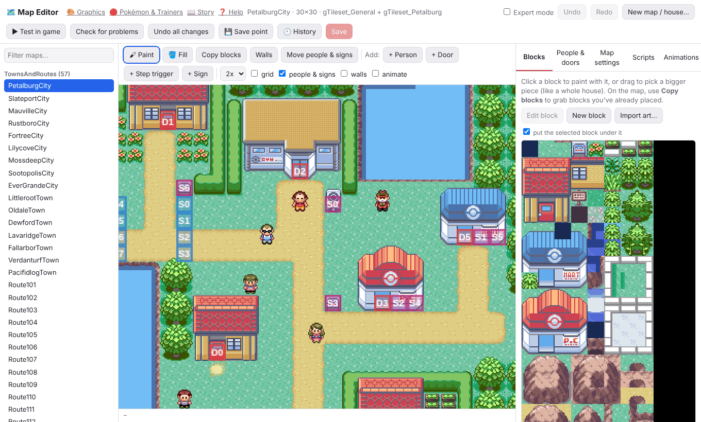

**What's inside**

| | |
|---|---|
| 🎯 [Missions](#new-to-rom-hacking) | small real tasks in your own game, one after another, ticked off by themselves |
| 🗺️ [Maps & events](#maps-people-and-doors) | paint maps, add houses, people, doors, signs and step triggers |
| 🧩 [Event builder](#build-what-happens-from-blocks) | make what people do from blocks (say, ask, give, battle, move…), and record walking paths |
| 🌍 [World & town map](#the-whole-world-and-the-town-map) | all maps joined together, new routes next to old ones, the town map, place names and fly spots |
| ▶️ [Test in game](#test-in-game-from-anywhere-in-the-story) | build and play right away, live at 60 fps with sound, from any chapter, with the items and team you choose |
| 🧪 [Replay tests](#replay-tests) | play something once, replay it after every change; a GitHub Action for every push |
| 🔴 [Pokémon & Trainers](#pokémon--trainers) | trainers, wild Pokémon, species, items, moves, TMs, shops, a level chart, and a one-click battle test |
| ✨ [New Pokémon](#a-brand-new-pokémon) | a brand-new species, copied from one you pick, with its own pictures |
| 🔎 [Find & replace](#find--replace-in-all-text) | rename a town or a person in every line of dialogue at once |
| 📦 [Release](#share-your-game) | a release build, a small BPS patch and a README to share your game |
| 💬 [Dialogue preview](#dialogue-that-fits) | see every text in the game's own font, with warnings for text that won't fit |
| 🌊 [Tileset animations](#water-and-flowers-that-move) | water, flowers and waterfalls: speed, frames and new animations |
| 📖 [Story flow](#story-flow) | which event turns on which flag, and what waits for it |
| 💾 [Save points](#save-points) | snapshots of your work you can always go back to |
| 🎨 [Graphics](#graphics) | all ~21,000 pictures of the game, sorted, with a pixel editor |
| ❓ [Help](#new-to-rom-hacking) | step-by-step guides and a dictionary of ROM-hacking words |

It can also extract and re-insert the graphics of unmodified retail GBA Pokémon
ROMs ([ROM mode](#rom-mode)).

## Install

You need a copy of your game's source code: your
[pokeemerald-expansion](https://github.com/rh-hideout/pokeemerald-expansion)
fork, for example. Pick one way to install:

**Linux or macOS**: one command installs everything (the compiler that builds
GBA games, the emulator library used for testing, and `pae`):

```bash
git clone https://github.com/malikpervez/pkmn-asset-editor
bash pkmn-asset-editor/scripts/install.sh
```

**Windows 10/11**: GBA games build on Linux, so the script installs WSL (Linux
inside Windows, from Microsoft) with Ubuntu and sets everything up there. Open
PowerShell **as administrator** in the downloaded folder and run:

```powershell
Set-ExecutionPolicy -Scope Process Bypass; .\scripts\install-windows.ps1
```

The first run may ask you to restart Windows. Run it again after restarting.

**Docker**: nothing to install except Docker:

```bash
docker build -t pae .        # if Docker Hub is busy: --build-arg BASE=public.ecr.aws/docker/library/ubuntu:24.04
docker run --rm -it -p 8765:8765 -v /path/to/your/game:/game pae
```

**With pip** (if you already have the toolchain): `pip install .` (Python 3.10+).
`scripts/setup-toolchain.sh` installs the toolchain with apt, dnf, pacman or Homebrew.

## Getting started

```bash
cd ~/my-expansion-game
pae doctor --fix      # checks everything and fixes what's missing
pae serve             # then open http://127.0.0.1:8765
```

`pae doctor` checks that your game can be built and tested and shows ✅ or ❌
for each thing. With `--fix` it asks before each fix: it installs missing
tools, turns on expansion's **Quickstart** (needed to start test games), makes
the game folder a git repository (for save points), and builds the game once.

<a id="new-to-rom-hacking"></a>
### New to ROM hacking? Start here

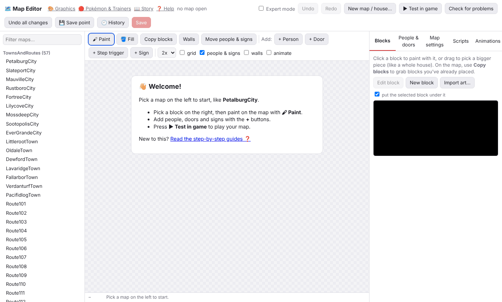

You don't need to know how to program. Press **❓ Help** at the top of any
page. It has step-by-step guides (change a Pokémon's picture, paint a map, add
a house, add a person who talks, change a trainer's team, test a battle, make
dialogue fit…) and explains every word you'll see, like *block*, *palette*,
*flag* and *script*.

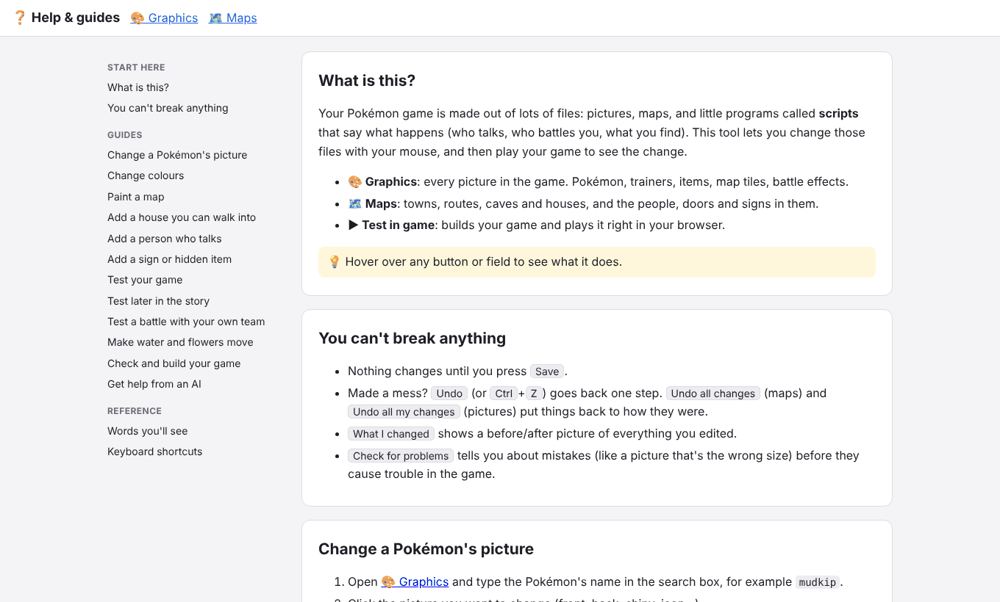

**🎯 Missions** (at the top of every page) take you through your first eleven
changes, one at a time: change what someone says, play it, rename a town,
change a trainer's team and the wild Pokémon, add a person, redraw a Pokémon,
save a checkpoint, make a save point, save a replay test and share your game.
Each mission says what to press and links to the right page, and ticks itself
off when the tool sees it done, by comparing your game folder with how it was
when the missions started. `pae missions` shows the same list.

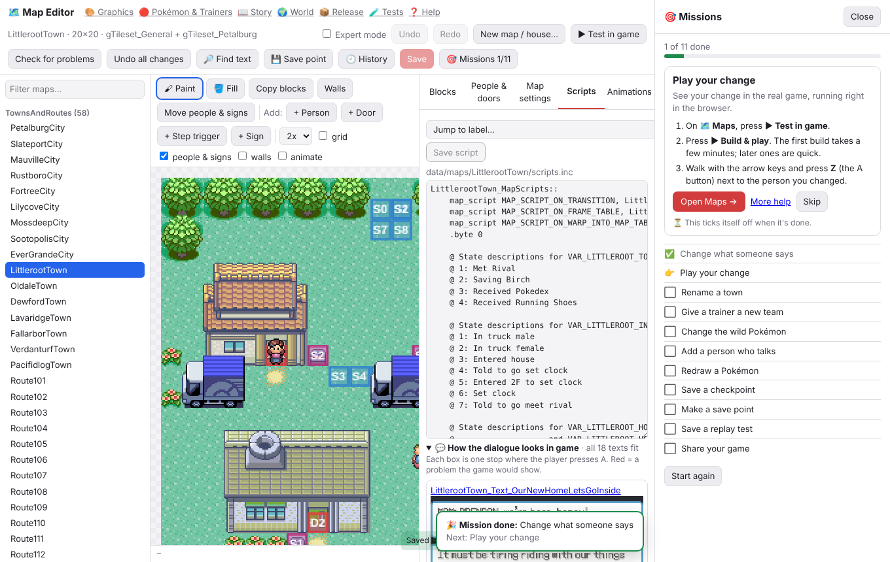

* Buttons and fields use plain words (**Walls**, **+ Door**, **looks like**,
  **what happens**). Hover over anything to see what it does.
* **Expert mode** shows every setting with the names the game's files use.
* **You can't break anything.** Nothing changes until you press **Save**.
  **Undo** and **Undo all changes** put things back, **What I changed** shows
  before/after pictures, and [save points](#save-points) let you go back to
  any earlier version.

## A tour

### Maps, people and doors

The **🗺️ Maps** page edits the same files as Porymap (`map.json`,
`layouts.json`, `map_groups.json`, `map.bin`, `scripts.inc`), so `make` picks
the changes up like any other edit.

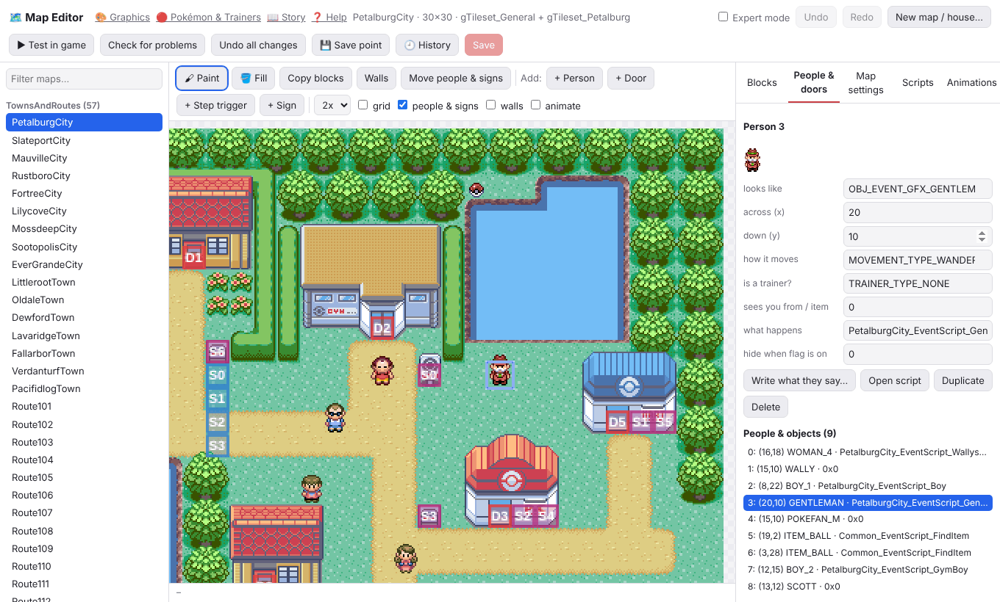

* **View any map** rendered from its real tilesets, with people drawn with
  their own sprites, plus doors (D), signs (S) and step triggers. There are
  optional grid and walls/height overlays.
* **Paint** with a block, or drag out a bigger piece (a whole house, a fence, a
  patch of grass). **Copy blocks** grabs blocks from any map to paste
  elsewhere. Fill, walls and undo/redo are there too.
* **People, doors, signs and step triggers**: add, drag, duplicate and delete
  them. Fields autocomplete from your own constants (`OBJ_EVENT_GFX_*`,
  `MOVEMENT_TYPE_*`, `FLAG_*`, `VAR_*`, `MAP_*`…) and script labels.
  **Write what they say…** writes a ready-made script from plain text, split
  into lines and boxes for you. *Make two-way* links a door and its
  destination.
* **New map / house…** copies an existing map, such as a house interior, under
  a new name (scripts and `LOCALID_*`s renamed, own layout, registered in
  `map_groups.json`/`layouts.json`). Add a door and click *Make two-way*.
* **New blocks and art.** The block editor sets each of the 8 tile slots, the
  behaviour (door, grass, water… from your `MB_*` enum) and the layer type,
  with an 8×8 pixel editor for tiles. **Import art…** turns any picture into
  new blocks: colours are matched to a palette (or written into one), it is
  cut into tiles reusing identical ones (also flipped), placed over a ground
  block so grass shows through, and you get a stamp to paint with. Engine
  limits (512/640 tiles and metatiles) are enforced, and `-num_tiles` in
  `graphics.h` is updated.
* **Scripts** tab: edit the map's `scripts.inc` (or `scripts.pory`) with a
  label list. *Open script* on an event jumps to its code.
* **Map settings**: music, weather, map type, flags, connections, resize, and
  the map's story chapter.
* **Check for problems** finds warps to missing maps, scripts that don't exist,
  unknown graphics, duplicate local ids, events outside the map, block data
  that doesn't match the layout, and blocks the tilesets don't have.

### Build what happens from blocks

**🧩 Build what happens** (on a selected person, sign or step trigger) makes
the script from blocks instead of code: 💬 say, ❓ ask yes or no (with a branch
for each answer), 🎁 give an item, 🔴 give a Pokémon, ⚔️ battle this trainer or a
wild Pokémon, 🚩 flags and 🔢 variables, 🔀 *if a flag is on…*, 🚶 move
someone, 👻 hide/👀 show a person, ❤️ heal, 🔔 sounds, 🎵 music, ⏳ wait,
🌑 fade, 🚪 go to another map, and ⌨️ a script line for experts. The right side
shows each text box as it will look in game, and the text is wrapped to fit.

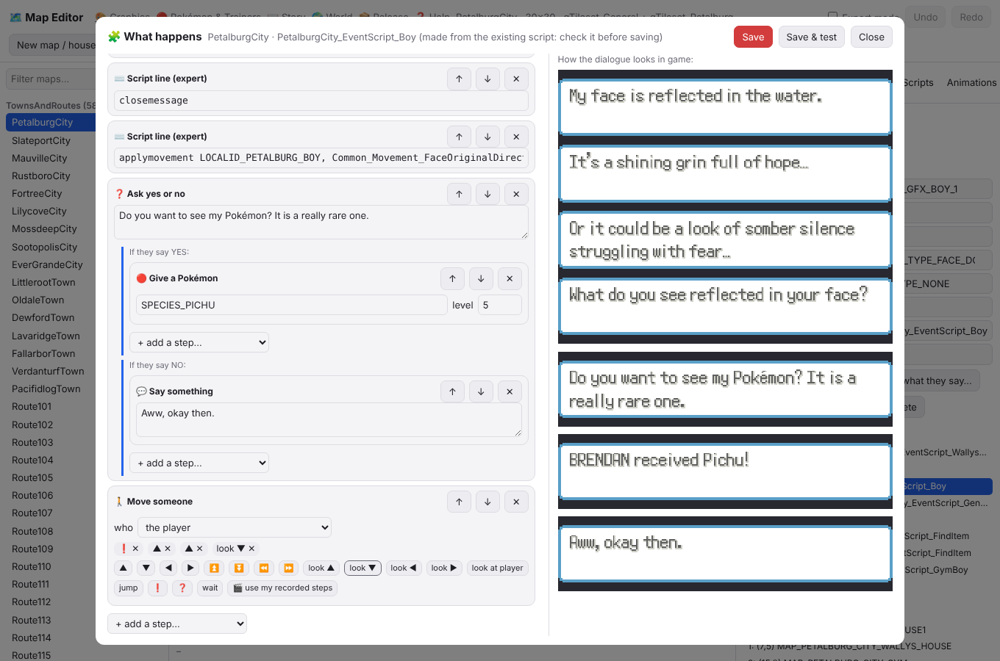

* The script and its texts and movements get readable labels
  (`PetalburgCity_EventScript_Boy1`, `…_Text_Boy1_2`) and are written to the
  map's `scripts.inc`. The blocks are kept in a `@ pae-blocks` comment above
  it, so the builder can open the script again later; scripts it didn't make
  are read into blocks as far as possible.
* **🎬 Record steps** in the test window: walk the path with the arrow keys,
  then use it in a 🚶 *Move someone* block.

### The whole world and the town map

The **🌍 World** page shows every outdoor map joined by its connections (the
edges you walk across), coloured by story chapter. Click a map to open it, or
**add a new map next to it**: a copy of a map you pick, connected on both
sides. It warns about connections that only go one way and maps that overlap.

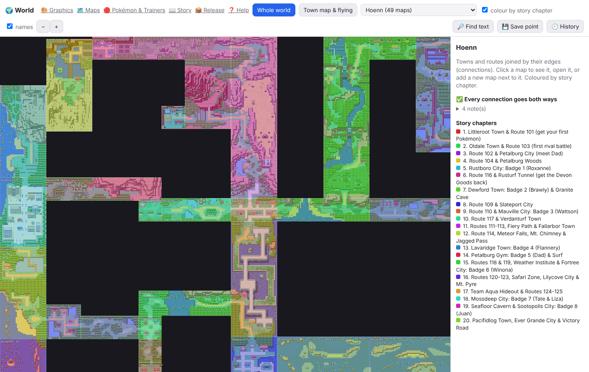

**Town map & flying** shows the town map from the game's own picture. Click a
square to see its place, paint squares to move a place, rename places (the
name on the town map and on the sign when you arrive), add new places, and
make a town a **fly spot** (where you land, and the flag that unlocks it).

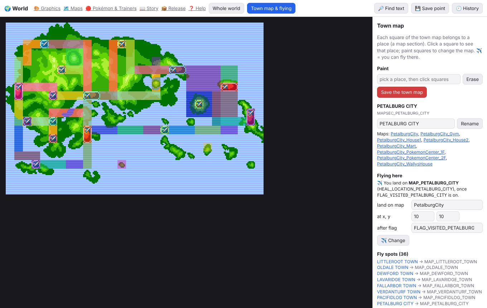

### Test in game, from anywhere in the story

**▶ Test in game** builds your game and plays it in the page, starting at the
spot you clicked. It asks three things:

1. **Where do you start?** A new game, a checkpoint (a saved game) or a `.sav`
   from your emulator.
2. **How far into the story?** Pick a chapter and you get the badges and
   everything you *need* by then (HMs, bikes, key items), with those events
   marked as done. Tick **Also give the extra items** for item balls, hidden
   items and gifts, and untick anything you don't want.
3. **Your team.** Type up to six Pokémon with a level, held item and moves, or
   leave it empty.

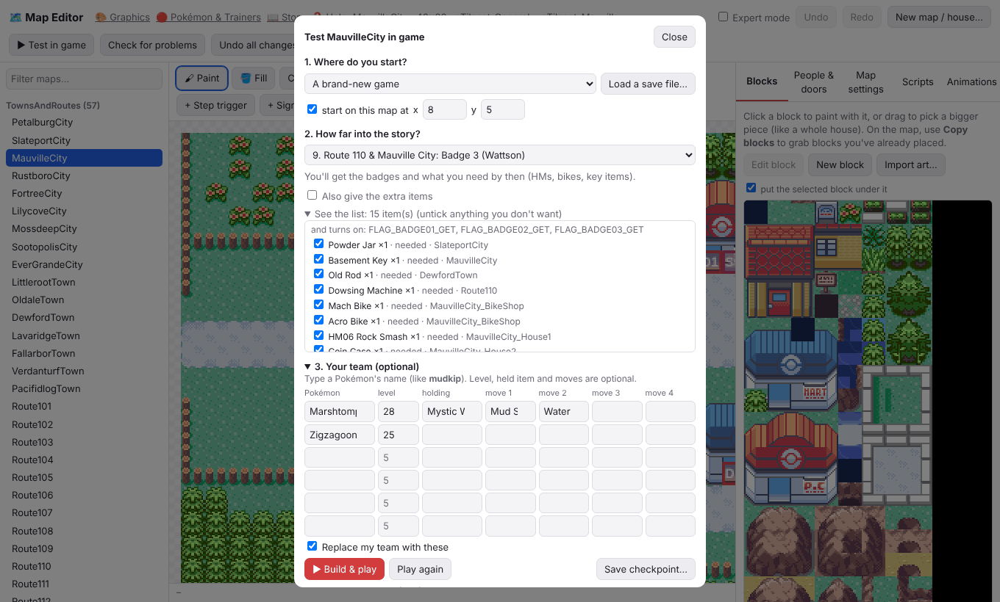

Then play with the keyboard or on-screen buttons, enter a list of inputs
(`UP*32, A, wait 60`), **Save checkpoint…** at any moment, and start a
**battle now** against any trainer or wild Pokémon. After an edit,
**Build & play** again. Small changes build in seconds.

**⚡ Live** (on by default) runs the game at full speed, 60 frames a second,
streamed to the page over a WebSocket, with **🔊 Sound**, **⏩ Fast** (4×, or
hold <kbd>Space</kbd>) and **⏸ Pause**. Starting battles, scripts and
checkpoints happen between two frames.

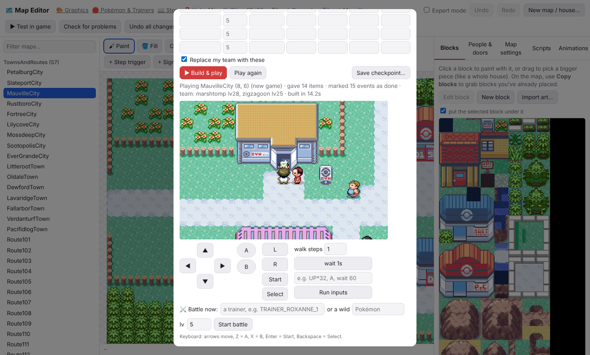

How it works: `make` runs, then the ROM boots in a headless libmgba driver
(`native/pae_mgba.c`, compiled on first use). A new game starts with
expansion's Quickstart, and `pae` **warps to the map** through `CB2_LoadMap`,
the same path a door takes (symbol addresses come from the build's `.elf`), so
people, map scripts and story triggers run as they do in a real game. Story
state, items and Pokémon are given with the game's own `FlagSet`, `VarSet`,
`AddBagItem` and `ScriptGiveMon`, using values from *your* headers, so
renumbered or new flags in a fork work. Checkpoints are written by the game's
own save routine and stored in `.pae/checkpoints/` as plain `.sav` files that
any emulator can load.

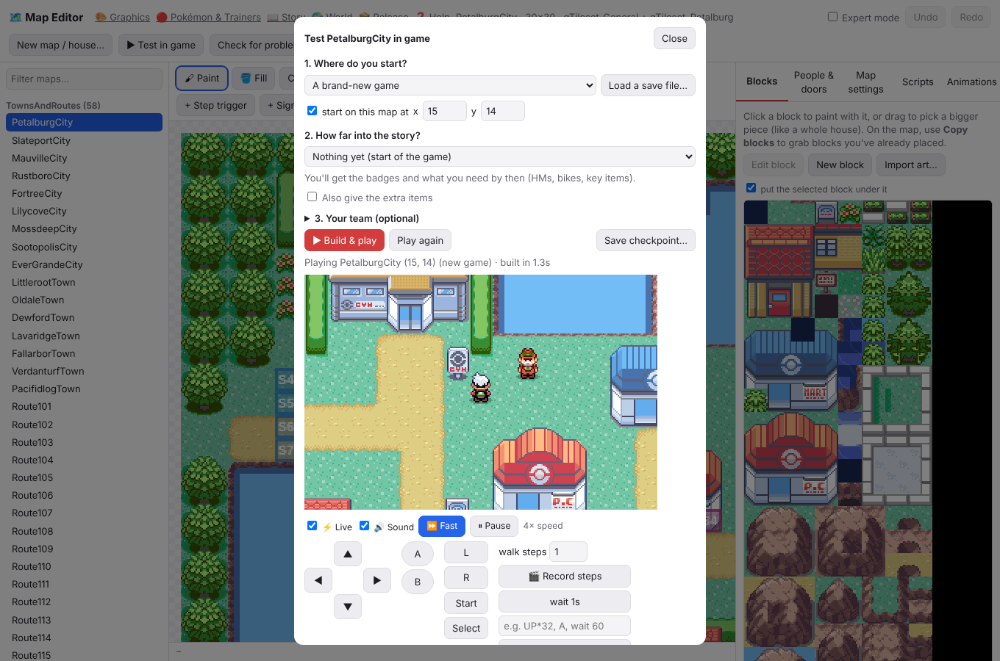

**Story chapters.** Emerald's 20 chapters are built in. The items come from
your maps: item balls (`finditem`), `hidden_item` signs and `giveitem` in
scripts, each with the `setflag` after it. Story items that are handed over
later (the Devon Goods, Steven's Letter) are left out once they're gone. Your
own maps are put in a chapter in **Map settings → Story chapter**, by
[Suggest chapters](#story-flow), or with `pae story`, and are saved in
`.pae/story.json`.

### Replay tests

Play something once (walk through a town, beat a gym leader, watch a
cutscene) and press **🔴 Save as a test…**. Everything since **▶** is saved in
`pae_tests/` in your game folder: where it started (map, checkpoint, chapter,
team), every button press and frame, every battle and script, and what the
game showed at the end. After a change, **🧪 Tests → Build & run all tests**
plays exactly the same inputs on the new build and tells you what is different:
the final screen, the map and position, whether a battle is going on, and the
trainers (beaten or not), flags and variables the test watches. If the change
was on purpose, **It's fine, keep the new result**.

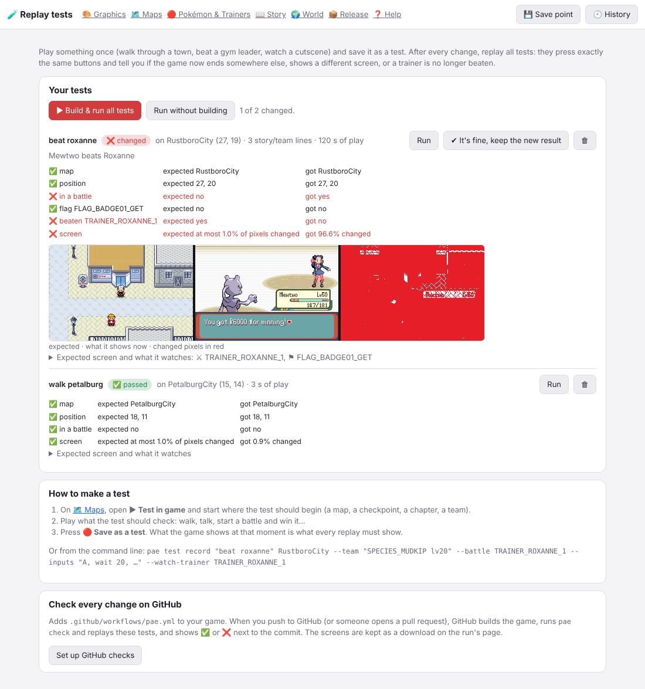

The emulator is deterministic, and every play-test starts with the same random
numbers (the game's RNG state is set on start), so people who wander around
walk the same way after a rebuild. Up to 1% of the screen may change by
default.

```bash
pae test record "beat roxanne" RustboroCity --clear-team --team "SPECIES_MEWTWO lv50 MOVE_PSYCHIC" \
    --state FLAG_BADGE08_GET --battle TRAINER_ROXANNE_1 --inputs "A*4, wait 20, A*4, wait 20, …" \
    --watch-trainer TRAINER_ROXANNE_1
pae test run                 # build, replay all, exit 1 when something changed
pae test accept "beat roxanne"
pae ci init                  # .github/workflows/pae.yml
```

**`pae ci init`** adds a GitHub Actions workflow to your game. On every push
and pull request GitHub installs the build tools and libmgba, builds the game,
runs `pae check --all`, replays the tests, puts a table in the run's summary
and keeps the screens (expected | now | changed pixels) as a download.

> Tip: in pokeemerald-expansion, Pokémon above the badge level cap don't obey
> (`B_OBEDIENCE_MECHANICS`). A test with a strong team needs badges too
> (`--state FLAG_BADGE08_GET`).

### Pokémon & Trainers

The **🔴 Pokémon & Trainers** page edits `src/data/trainers.party`,
`src/data/wild_encounters.json` and the species data, with names instead of
constants and the Pokémon's icons next to them.

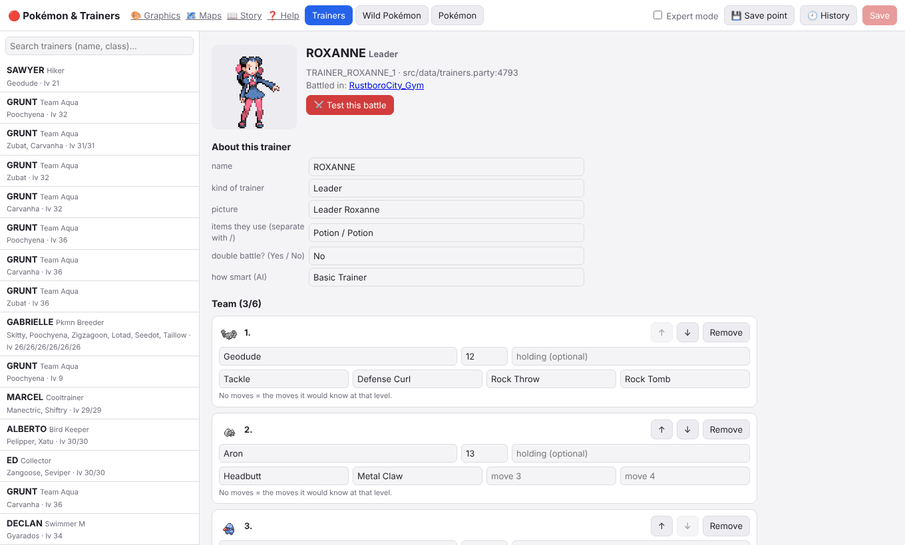

* **Trainers**: name, class, picture, items, double battles, AI and the team
  (Pokémon, level, held item, ability, moves, and the rest of the Showdown
  syntax). It shows which map the trainer is battled on. Only the edited
  trainer's lines are rewritten, so the rest of the file stays byte for byte
  the same.
* **⚔️ Test this battle** builds the game and starts the battle immediately
  with the team you choose:

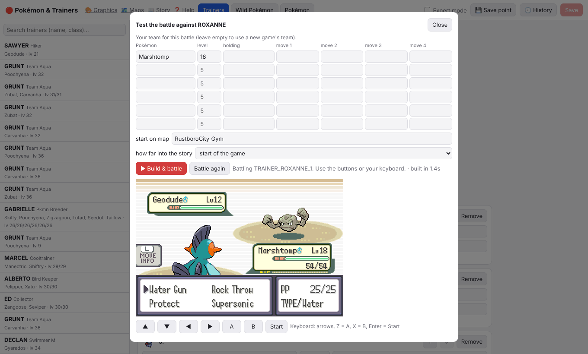

* **Wild Pokémon**: every encounter slot of a map (grass, surfing, rock smash,
  fishing rods) with the chance of each slot, levels and the encounter rate.
  The ⚔️ button on a row battles that Pokémon.

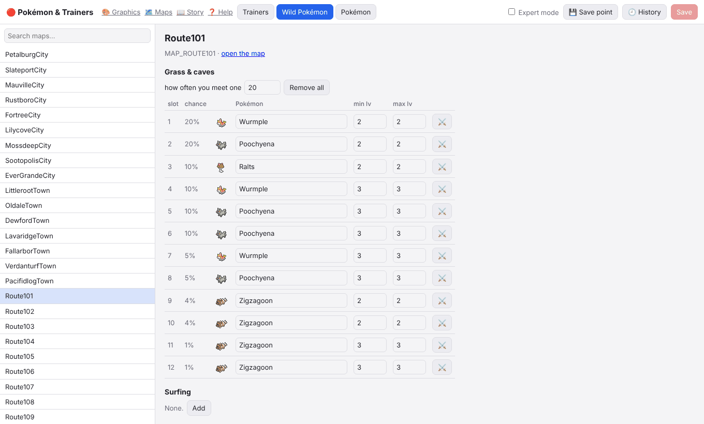

* **Pokémon**: types, base stats, abilities, catch rate, EXP, evolutions and
  level-up moves. `#if` config branches (`P_UPDATED_TYPES`, …) and ternaries
  are evaluated, so you edit the values your build really uses, and the
  learnset file chosen by `P_LVL_UP_LEARNSETS`.

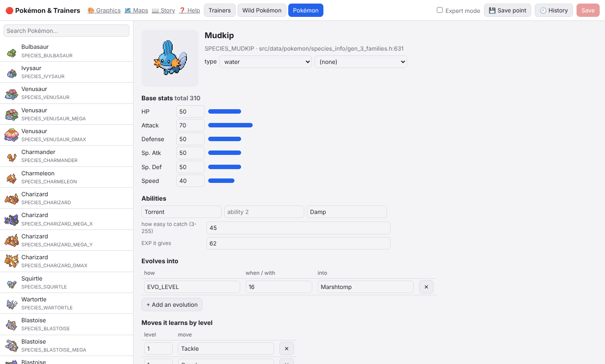

* **Pokédex and names**: name, category, height, weight and the Pokédex
  text, plus which TMs, HMs and tutor moves it learns and its egg moves.
* **Items**: name, price, description and bag pocket, and the shops that sell it.
* **Moves**: power, accuracy, PP, priority, type, category and description, and
  who learns it.
* **TMs**: which move each TM and HM teaches. Changing one renames the TM item
  everywhere (`ITEM_TM_OVERHEAT`…), and a move can't be a TM and an HM at once.
* **Shops**: what each Poké Mart sells.

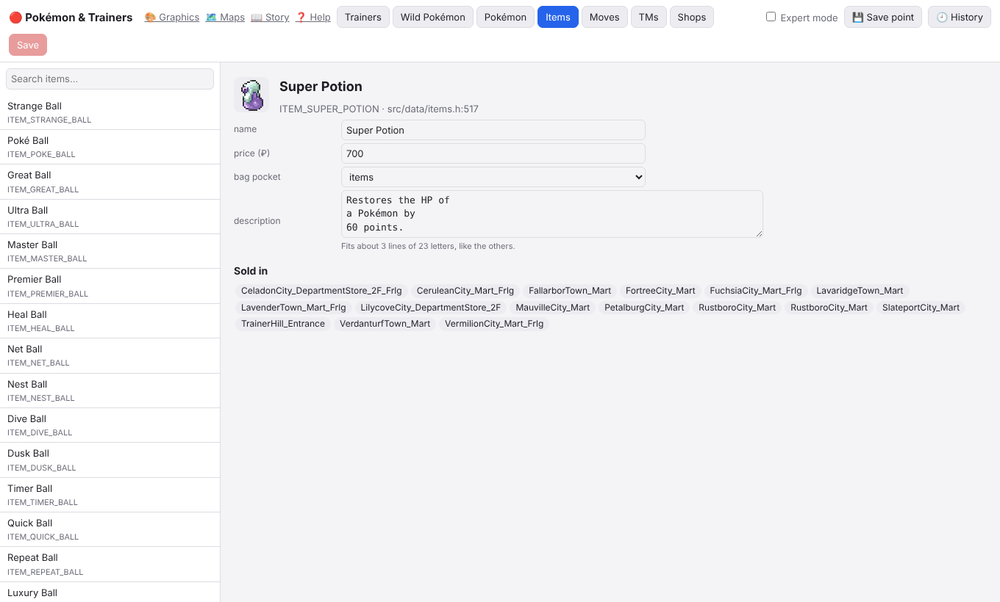

* **Difficulty**: the levels of every trainer and the wild Pokémon chapter by
  chapter on one chart, with the gym leaders marked, and a list of trainers and
  wild Pokémon that look too strong for their chapter.

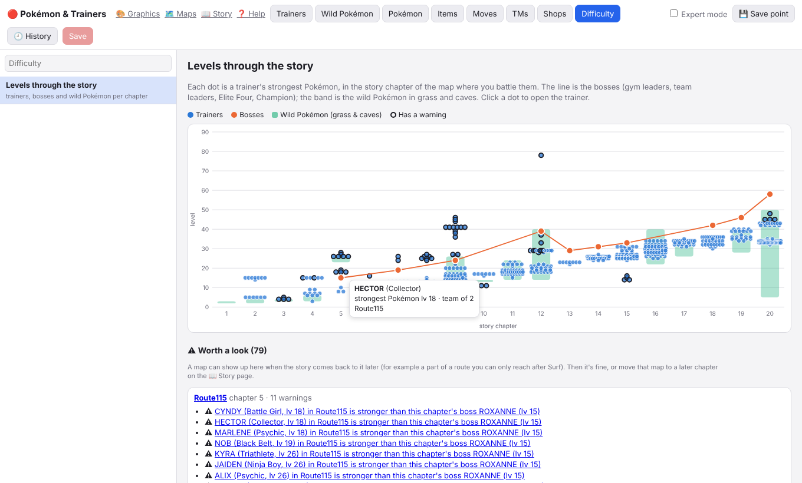

**Check for problems** warns about unknown species, moves and items,
levels out of range, too many Pokémon or moves, slot counts that
don't match the encounter type, names that are too long and shops or TMs
with unknown items or moves.

### A brand-new Pokémon

**✨ New Pokémon** (on the Pokémon tab) adds a new species the way expansion's
`how_to_new_pokemon.md` tutorial describes, by copying one you pick: its
`SPECIES_` and `NATIONAL_DEX_` constants, a Pokédex entry at the end with the
name/height/weight orders updated, its species entry (in
`species_info/custom_families.h`), its own graphics folder and `INCGFX` lines,
follower sprite, learnsets, egg moves and TM/tutor moves. Give it a name,
types, stats, a Pokédex text, an evolution and your pictures. Its cry is the
template's.

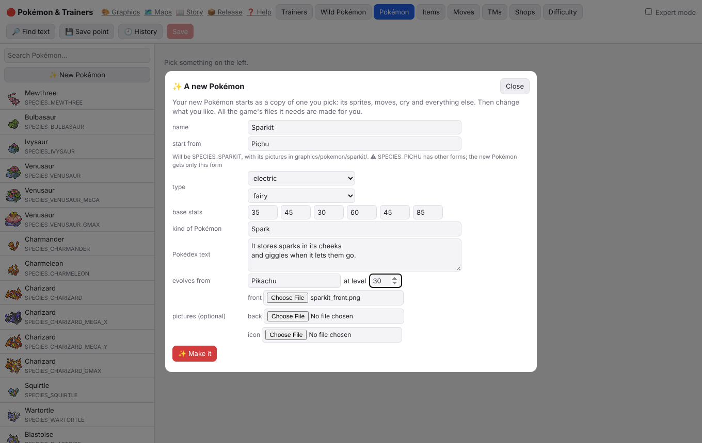

### Find & replace in all text

**🔎 Find text** (at the top of the editor pages) searches all dialogue, place names and
trainer names, including words split over two lines ("PETALBURG\nCITY").
**Replace** keeps the case (`petalburg` → `Sunny` turns `PETALBURG` into
`SUNNY`) and re-wraps only the text boxes that no longer fit. You see every
change first and can untick any.

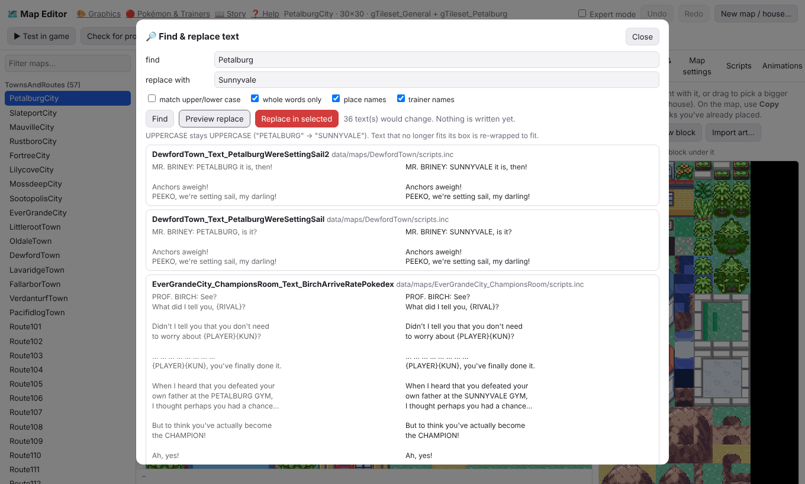

### Dialogue that fits

The **Scripts** tab draws every text of the map in the game's own font
(`graphics/fonts/latin_normal.png`, `gFontNormalLatinGlyphWidths` and your
`charmap.txt`), one picture per text box, and updates as you type.

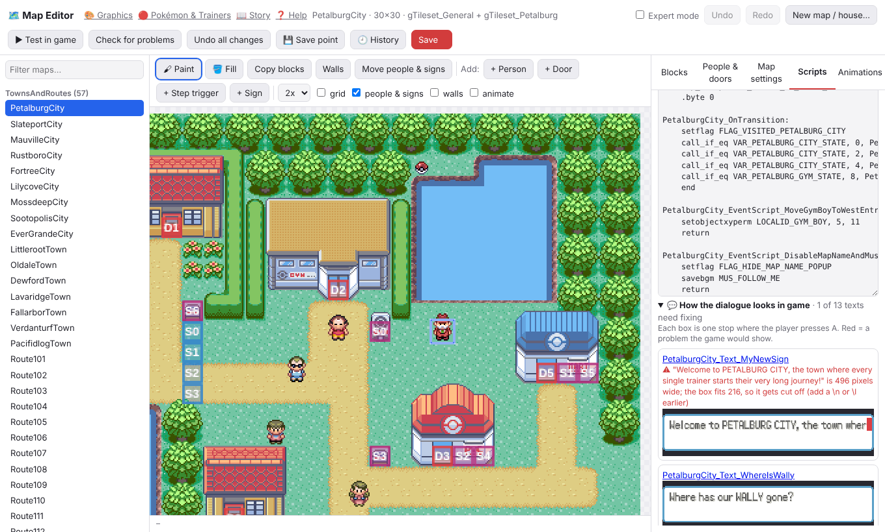

It warns about lines wider than the box (216 pixels), a third line that needs
`\l`, characters that aren't in the charmap, unknown `{PLACEHOLDERS}` and a
missing `$`. **Check for problems** and `pae text check` report the same for
the texts you changed.

### Water and flowers that move

Animated tiles are read from `src/tileset_anims.c` (frame PNGs, frame tables,
the tiles each animation overwrites, and the `timer % N` timing in each
tileset's callback), so custom animations in your fork are picked up too.

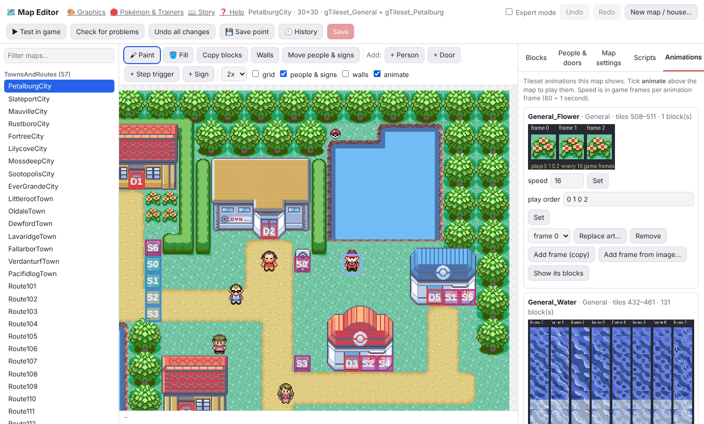

* Tick **animate** to play them on the map. The preview uses the game's
  timing; it was checked frame by frame against the emulator's video memory,
  including Rustboro's staggered water.
* The **Animations** tab shows the frames in their in-game colours. Change the
  speed and play order (`0 1 0 2`), add frames (a copy or an image), replace a
  frame's art (colours are matched to the palette those tiles use) and remove
  frames.
* **New animation** animates tiles of your own tilesets (water you drew for a
  new town). It writes the frame PNGs, table, queue function and callback, and
  hooks up the tileset's `InitTilesetAnim_*` (and `headers.h` if needed).

`pae check` warns about frame images with too few tiles, frame counts that
cause a visible jump once per cycle, animations that never run, and too many
tile copies on one game frame.

### Story flow

The **📖 Story** page shows the story chapter by chapter: each map's events and
what they do, as coloured chips: **turns on** and **turns off** a flag,
**needs** a flag, and sets or checks a **variable**. Click a chip, or search
for a flag like `BADGE01`, to see every event that changes it and every event
that waits for it.

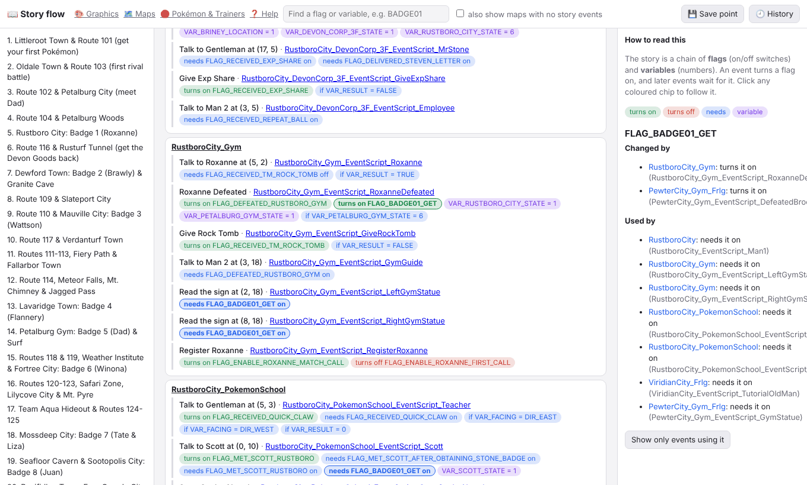

It reads `setflag`/`clearflag`, `goto_if_set`/`call_if_unset`,
`setvar`/`addvar`, `goto_if_eq`/`call_if_eq` on variables, `map_script_2`
conditions, people hidden by a flag and step triggers that wait for a variable
value.

**Suggest chapters** places maps that aren't in a chapter yet (your new towns
and houses) by following their doors and map connections to a place that is,
skipping hub maps such as Pokémon Centers that connect to everywhere.

### Share your game

The **📦 Release** page makes what you share: `make release` (no debug menus or
Quickstart), a **BPS patch** against the original game (a few MB for a whole
expansion game, because data that only moved is copied, not stored), an
optional UPS patch, and a README with how to play and what's new (your save
points since the last release). The original game's checksum is checked, so
the README says exactly which file players need. Everything goes into
`.pae/releases/` and a zip.

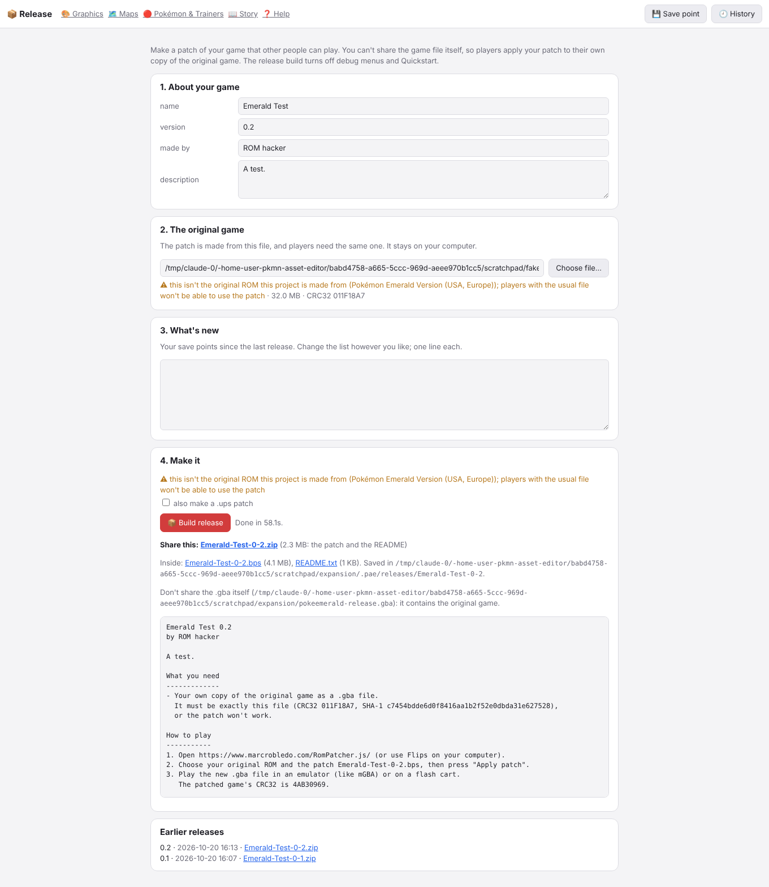

### Save points

**💾 Save point** remembers everything in your game folder as it is now, with
a name you choose (or one made for you, like *"Changed maps (PetalburgCity)"*).
**🕘 History** lists them, shows what changed in each, and goes back to one.

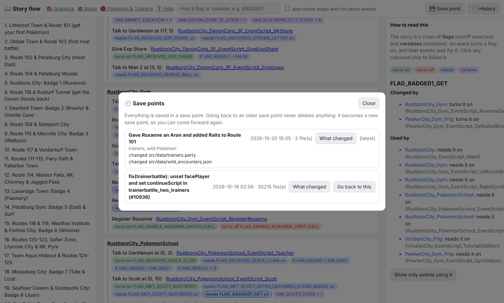

Save points are git commits. Going back never deletes history: the files are
restored and saved as a new save point, so you can always come forward again,
and unsaved changes are kept in a save point of their own first. If git has no
name configured, save points are made as "ROM hacker".

### Graphics

The **🎨 Graphics** page sorts every picture in the game into categories with
search. Click one to draw on it with the colours it really uses in game.

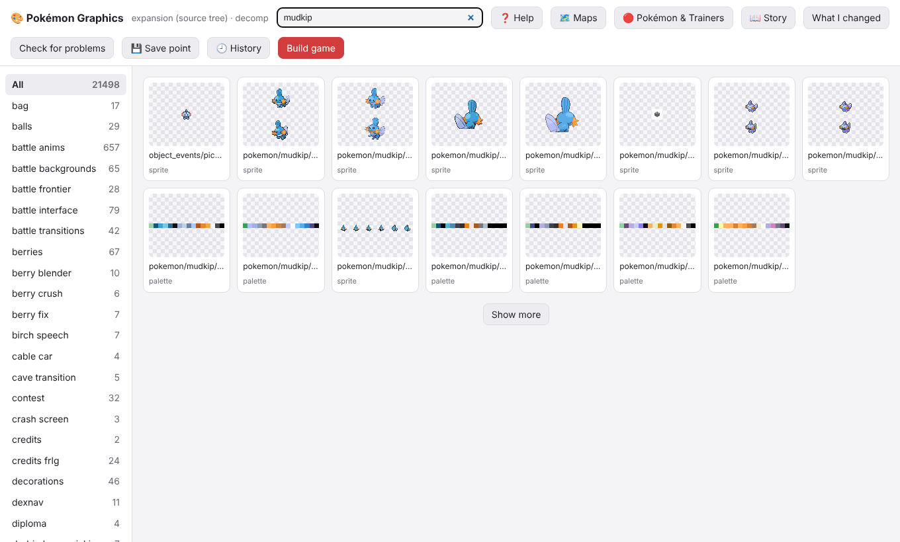

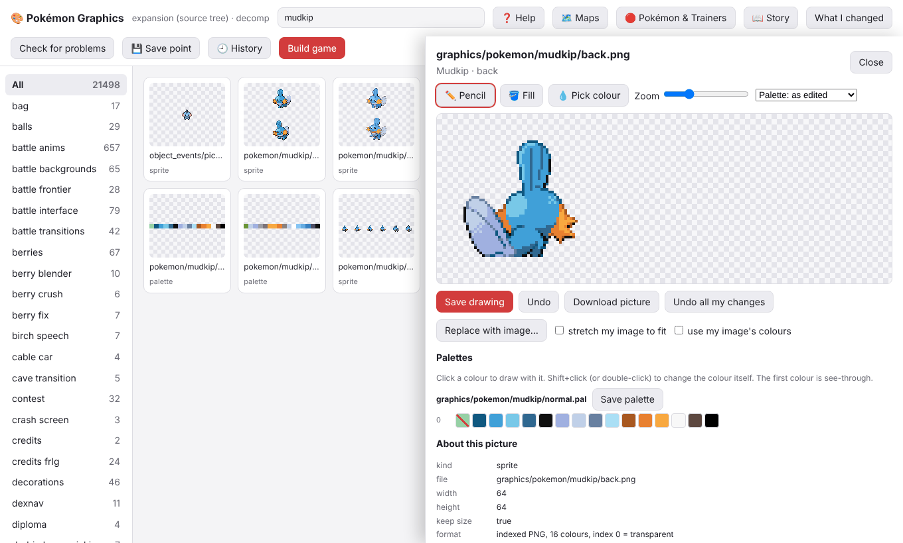

* Pencil, fill, pick colour, zoom and undo. Click a palette colour to draw with
  it, shift-click to change the colour itself (every picture sharing that
  palette is recoloured).
* **Replace with image…** takes any PNG: it is resized if you want, and mapped
  to the palette, or a new palette is built from it.
* **What I changed** shows before/after pictures of every edited sprite,
  palette, tileset and map, and text diffs of scripts and data. This makes it
  easy to review what an AI changed.

How the graphics are organised (source tree):

* **An organised index of all ~21,000 graphics**, built from the `INCGFX_*` /
  `INCBIN_*` references in `src/` (symbol names, output format, gbagfx
  arguments such as frame sizes), grouped into categories (pokemon, trainers,
  items, battle_anims, overworld, tilesets, …). Unreferenced files are flagged.
* **The palette each image really uses in game**, which is often not the PNG's
  own palette:
  * Pokémon sprites → `normal.pal` / `shiny.pal`. Forms inherit from the parent
    folder. Overworld followers → `overworld_normal.pal`.
  * Icons → `icon_palettes/palN.pal` via `.iconPalIndex`, including ternaries
    on config flags.
  * Overworld sprites → `.paletteTag` through the graphics info and palette
    tag tables.
  * Trainers and items → paired symbols like `gTrainerFrontPic_X` ↔
    `gTrainerPalette_X`, or `{ .iconPic, .iconPalette }` initializers.
    Alternative palettes (shiny, a shared icon used by Super Potion) can be
    previewed.
* **Coloured, editable views of tilesets** (`…/general@tileset`). Each tile is
  shown with the palette `metatiles.bin` gives it, and secondary tilesets
  borrow their primary's palettes via `layouts.json`. **Tilemap backgrounds**
  (`…/dark@bg`, battle environments, title screens) can be edited as one image
  and are re-cut into tiles and a `.bin` tilemap.
* **Validation (`pae check`)** that catches what breaks `make` or looks wrong:
  * RGB/RGBA PNGs (gbagfx rejects them)
  * sizes that are not multiples of 8, changed sizes, sheets that don't split
    into frames
  * colour indices above 15, which gbagfx silently wraps
  * PNG palettes that grew, which overwrites neighbouring palettes in game
  * colours edited in a PNG whose in-game palette is a separate `.pal`
  * deleted files still referenced by the source
* **Artwork conversion (`pae import`)**: any PNG (RGBA, any size, any number of
  colours) is turned into a valid indexed PNG mapped to the in-game palette.
  `--new-palette` builds a fresh palette, writes `normal.pal`, and remaps the
  sibling sprites that share it. Art shaped like one frame fills every
  animation frame.
* **git-based** status and revert, and `pae build` = check + `make`.

## Command line

Everything in the web editor also works from the command line, and every
project command takes `-p/--project DIR` (default `.`, or `$PAE_PROJECT`).

```bash
# graphics
pae check --all                       # sanity-check the whole tree (fast, read-only)
pae list -c pokemon -q charizard
pae describe graphics/pokemon/charizard/anim_front.png     # size, frames, in-game palette, symbols
pae import graphics/pokemon/charizard/back.png new_art.png --resize
pae check                             # validates only what you changed
pae build                             # check, then `make -jN` (pae build --make "make -j8 DEBUG=1")
pae revert --all                      # undo (git checkout of the edited files)

# maps and dialogue
pae map render PetalburgCity -o petalburg.png --scale 2
pae map metatiles PetalburgCity -o metatiles.png           # ids to paint with
pae map new PetalburgCity_House1 PetalburgCity_House3       # new house interior
pae map link PetalburgCity 6 PetalburgCity_House3 0         # door <-> house, both ways
pae map import-art PetalburgCity cottage.png --x 24 --y 6 --solid
pae text check PetalburgCity                                # text that won't fit
pae text preview PetalburgCity PetalburgCity_Text_WhereIsWally -o text.png

# trainers, wild Pokémon, species
pae trainer list roxanne
pae trainer set TRAINER_ROXANNE_1 --mon "Geodude lv12 @Oran Berry : Tackle, Rock Tomb" --mon "Aron lv13"
pae trainer new TRAINER_WALLY_2 --like TRAINER_WALLY_1 --mon "Ralts lv16" --field Mugshot=   # Key= removes a field
pae wild show Route101
pae wild set Route101 land Wurmple:2-2 Poochyena:2-2 Ralts:2-2 … --rate 20     # one per slot (12 for land)
pae species show mudkip
pae species set mudkip --spe 50 --types TYPE_WATER,TYPE_GROUND --learn 1:Tackle --learn "6:Water Gun"

# play-test
pae play PetalburgCity --x 17 --y 11 --inputs "UP, wait 10, A, wait 60" -o sign.png --gif sign.gif
pae play MauvilleCity --chapter 9 --extras \
    --team "SPECIES_MARSHTOMP lv28 ITEM_MYSTIC_WATER MOVE_MUD_SHOT MOVE_WATER_GUN" --clear-team
pae play RustboroCity_Gym --battle TRAINER_ROXANNE_1 --team "SPECIES_MARSHTOMP lv18" --clear-team
pae play Route101 --wild SPECIES_RALTS:5
pae play PetalburgCity --state "FLAG_BADGE01_GET, VAR_PETALBURG_GYM_STATE=2, ITEM_POTION*5" \
    --script PetalburgCity_EventScript_GymSign --save-as gym-test
pae checkpoint import before-gym ~/emerald.sav       # use a save from your emulator / flash cart
pae play --from before-gym                           # continue it where it was saved

# items, moves, TMs, shops, levels, new Pokémon
pae item set ITEM_SUPER_POTION --price 600
pae move set MOVE_TACKLE --power 50 --accuracy 95
pae tm set tm 50 MOVE_FLAMETHROWER          # renames ITEM_TM_<MOVE> everywhere
pae mart set OldaleTown_Mart_Pokemart_Basic ITEM_POTION ITEM_POKE_BALL ITEM_ANTIDOTE
pae difficulty                              # levels per chapter and the spots that look wrong
pae new-pokemon Sparkit --from SPECIES_PICHU --types TYPE_ELECTRIC,TYPE_FAIRY --stats 35,45,30,60,40,85 \
    --evolves-from pikachu:30 --front sparkit.png

# world, text, replay tests, releases
pae world render -o hoenn.png                    # all maps joined by their connections
pae world attach Route101 down Route102 Route101_South
pae world fly MAPSEC_SUNNY_TOWN SunnyTown 10 8 --flag FLAG_VISITED_SUNNY_TOWN
pae text find "Petalburg"
pae text replace "Petalburg" "Sunnyvale" --dry-run
pae test record "walk petalburg" PetalburgCity --inputs "RIGHT*48, UP*32"
pae test run                                     # see "Replay tests" above
pae release --name "Emerald Sunny" --version 1.0 --base ~/emerald.gba
pae missions                                     # the guided missions

# story, animations, save points
pae story list                      # the chapters and their maps
pae story items 9 --extras          # what you'd have by the end of chapter 9
pae story flag FLAG_BADGE01_GET     # which events change and check it
pae story suggest --apply           # put new maps in chapters by their doors
pae story add "Badge 9: Cloud City" --flag FLAG_BADGE09_GET
pae anim speed General_Water 12     # game frames per animation frame (60 = 1 s)
pae anim new PetalburgCity PondWater --tile 532 --count 4 --frames 4 --speed 16
pae savepoint "Gave Roxanne an Aron"
pae history / pae history show SHA / pae history back SHA
```

`--state` takes `FLAG_X` (set), `!FLAG_X` (clear), `VAR_X=5`, `ITEM_X*3`
(give), `SPECIES_X lv20 ITEM_Y MOVE_Z…` (add a Pokémon), `CLEAR_TEAM` and
`CALL Function` (run a game function, e.g. one that sets up a region's save
data); flags and variables with a prefix (`JOHTO_FLAG_X`, `JOHTO_VAR_X=2`)
work the same. `pae trainer new` gives the new trainer the next number after
the highest one of its file, raises the trainer count and adds the same line
to a header that numbers trainers from a base (an alias for a second region).
`--inputs` takes `KEY`, `KEY*frames` (16 frames = one step), `A+B 4` and
`wait 60`. A full team sends the rest to the PC. A checkpoint keeps working
after you rebuild, as long as the save layout does not change (the same rule
as for real saves).

## ROM mode

Extract every graphic from a retail ROM into an organised folder of ordinary PNG
and palette files, edit them, then **rebuild the ROM** with all edits inserted.
Data that grows is relocated and its pointers are updated automatically.
Graphics tables are found by their structure, not by hardcoded offsets, so
every language and revision works, including binary hacks whose tables were
moved. pokeemerald-expansion games use different data structures and their own
compression, so use source-tree mode for those.

| What | Where it ends up |
|---|---|
| Pokémon front/back battle sprites, normal + shiny palettes, party icons | `graphics/pokemon/NNN_name/` |
| Trainer battle pictures + palettes | `graphics/trainers/NNN/` |
| Item icons + palettes | `graphics/items/NNN_name/` |
| Battle-animation sprites (laid out as animation frames) + palettes | `graphics/battle_anims/sprites/TAG/` |
| Battle-animation backgrounds (full tilemap images) | `graphics/battle_anims/backgrounds/NN/` |
| Battle backgrounds (terrain scenes and entry graphics) | `graphics/battle_backgrounds/NN/` |
| Overworld sprites (all walking/animation frames) + palettes | `graphics/overworld/NNN/` |
| Map tilesets (tiles in their real colours + 16 palettes) and metatile previews | `graphics/tilesets/`, `previews/tilesets/` |
| Any other LZ77-compressed graphics referenced by the game (title screens, menus, …) | `graphics/unknown/OFFSET.png` |

```bash
pae scan  firered.gba                 # see what is found (no files written)
pae extract firered.gba -o fr-project # writes graphics/, manifest.json, AGENTS.md
cd fr-project

pae serve                             # web editor at http://127.0.0.1:8765
#   or edit graphics/**/*.png and *.pal with any editor (Aseprite, GIMP, Usenti, …)

pae status                            # what you changed
pae validate                          # check sizes, colours, conflicts, tile limits
pae build                             # -> build/rom.gba + build/rom.ups + build/rom.ips
```

You must supply your own legally obtained ROM. ROMs and built files are
git-ignored. `original.gba` inside the project is never modified. Every build
starts again from it, so builds are repeatable and you can never corrupt your
base ROM. The [Graphics](#graphics) page works the same way on a ROM project,
and its **Build ROM** button writes the ROM and lets you download it or the
patches.

### Editing rules (both modes)

The tool enforces these rules and converts input for you wherever it can:

1. **Image sizes are fixed.** `pae import <id> art.png --resize` scales new art.
2. **Sprites use 16 colours, and index 0 is transparent.** Sprite PNGs are
   4-bit indexed. You can keep them indexed (same palette order) or save any
   RGB/RGBA PNG; colours are then mapped to the nearest palette entry.
   `--new-palette` builds a fresh 16-colour palette from the art.
3. **Colours are 15-bit**, so each channel is rounded to a multiple of 8.
4. **Palettes** can be edited in the `.pal` file (JASC-PAL text) *or* in the
   PNG's own palette. If both are edited, the `.pal` file wins. If two PNGs
   change the same palette colour differently, the build stops and tells you
   which ones conflict.
5. **Tilesets and backgrounds** are 8-bit indexed PNGs with `pixel = bank*16 + colour`,
   so they display in their real in-game colours.
   * Tilesets store only the colour part. The palette a tile uses in-game is
     chosen by the metatile.
   * Backgrounds are re-cut into 8x8 tiles automatically, with de-duplication
     including flipped tiles. They may not need more unique tiles than the
     original, because extra tiles would overflow the VRAM slot. Backgrounds
     that share tiles with another background are edited in place instead.
6. Overworld frames, icons and tileset palettes are stored uncompressed in the
   game, so they are always written in place.

### How reinsertion works

* Each asset points at one or more **blobs**: pieces of ROM data, either
  LZ77-compressed or raw. The build decodes every edited file and compares it
  with the original data. Only data that really changed is written; re-saving
  an image with identical pixels is a no-op.
* When several assets share a blob (one palette used by a front and back
  sprite, one tile sheet used by two backgrounds), their edits are merged per
  tile or per colour, and contradictory edits are reported.
* Compressed data is re-compressed with an optimal-parse, VRAM-safe LZ77
  encoder. If it still fits in its original slot it is written **in place**.
  Otherwise it is **relocated** into free space (runs of `0xFF` that nothing
  points into, biggest region first) and **every pointer** to the old location
  is updated. If no space is left, the ROM is expanded to 32 MiB.
* Every written block is decompressed again and verified before the ROM is
  saved. `build/build-report.json` lists everything that was written, moved and
  repointed.
* **UPS** and **IPS** patches are generated next to the ROM so you can share
  your work without distributing the game. `pae apply-patch` applies them.

## Using it with AI

The project is designed so an AI assistant can work on your game directly, and
you can review everything it did under **What I changed** and **🕘 History**.

* **MCP server**: `pae mcp --project <dir>` gives an AI 88 tools, many of which
  return pictures, so it can see what it is doing:
  * graphics: `list_assets`, `describe_asset`, `view_asset`,
    `view_contact_sheet`, `get_pixels`/`paint_pixels`, `import_image`,
    `set_palette`, `revert_asset`
  * maps: `list_maps`, `view_map`, `get_map`, `view_metatiles`,
    `get_blocks`/`set_blocks`, `copy_blocks`, `edit_map`, `duplicate_map`,
    `link_warps`, `resize_map`, `find_constants`, `tileset_info`,
    `get_metatile`/`set_metatile`/`add_metatiles`, `view_tiles`,
    `import_art_as_metatiles`
  * scripts and dialogue: `get_script`, `write_script` (reports text that won't
    fit), `new_script`, `preview_text`
  * game data: `list_trainers`, `get_trainer`, `set_trainer`, `get_wild`,
    `set_wild`, `get_species`, `set_species`, `list_items`/`get_item`/`set_item`,
    `list_moves`/`get_move`/`set_move`, `get_tms`/`set_tms`, `get_teachable`,
    `list_marts`/`set_mart`, `difficulty_report`, `create_pokemon`
  * world: `view_world`, `region_map`, `attach_map`, `set_fly_spot`
  * events from blocks: `build_script`, `get_blocks_script`
  * text: `find_text`, `replace_text`
  * replay tests: `save_replay_test`, `run_replay_tests` (returns the
    difference pictures), `accept_replay_test`
  * play-testing: `playtest_start` (map, chapter, extras, team),
    `playtest_press`, `playtest_battle`, `playtest_team`, `playtest_set_state`,
    `playtest_run_script`, `playtest_save_checkpoint`, `list_checkpoints`
  * story: `list_story_chapters`, `story_items`, `set_map_chapter`,
    `story_flag`, `suggest_map_chapters`
  * animations: `list_tileset_anims`, `view_tileset_anim`,
    `edit_tileset_anim`, `set_anim_frame`/`add_anim_frame`/`remove_anim_frame`,
    `create_tileset_anim`
  * `status`, `validate`, `build_rom`, `list_save_points`, `make_save_point`
    and `make_release` (only when you ask for one)

  ```bash
  claude mcp add pae -- pae mcp --project ~/my-expansion-game       # Claude Code, source tree
  claude mcp add pae -- pae mcp --project /path/to/fr-project       # or an extracted ROM project
  ```
  ```json
  { "mcpServers": { "pae": { "command": "pae", "args": ["mcp", "--project", "/path/to/my-expansion-game"] } } }
  ```
* **`pae guide`** prints instructions for AI agents working in your repo
  (`pae guide > GRAPHICS_AGENTS.md`). ROM projects get an `AGENTS.md`.
* **`manifest.json`** (ROM projects), `pae describe <id>` and
  `pae list --json` describe every asset with its constraints.
* **`pae import`** and **`pae import-dir`** accept whatever an image generator
  produces (RGBA, any size, any number of colours). `import-dir` mirrors asset
  ids, so `drop/pokemon/025_pikachu/front.png` replaces that sprite: bulk
  updates of whole parts of the game are one command.

Example prompts:
*"Add a new house to Petalburg City with an old man inside who gives you a
Potion, then test it in game and show me a screenshot."*
*"Make Roxanne harder: give her an Aron and a Nosepass at level 15, then
test the battle with a level 16 Marshtomp."*
*"Give every Fire-type Pokémon's shiny palette a blue tint, show me a contact
sheet of the results, then run `pae check`."*

## Command reference

| Command | Purpose |
|---|---|
| `pae serve` / `pae mcp` | web editor / MCP server |
| `pae doctor [--fix] [--yes]` | check (and fix) the toolchain, emulator, Quickstart, git repo and built ROM |
| `pae check [--all]` | source tree: validate edited files (or every graphic) |
| `pae build` | check, then `make` (source tree) or write the ROM and patches (ROM project) |
| `pae fix [FILE…]` | convert RGB/RGBA PNGs into valid indexed PNGs |
| `pae palette-from-png FILE…` | source tree: copy a PNG's colours into the `.pal` the game uses for it |
| `pae list [-c CATEGORY] [-k KIND] [-q TEXT] [--json]` / `pae describe ID` | list assets / one asset and its constraints (JSON) |
| `pae import ID FILE [--resize] [--new-palette]` / `pae import-dir DIR` | convert and insert images (or `.pal`/JSON palettes) |
| `pae set ID [--frame-w N --frame-h N --cols N --tiles-wide N --palette ID --label TEXT]` | re-layout or re-colour an asset's view |
| `pae sync-palettes [ID…]` | recolour PNGs after editing `.pal` files |
| `pae sheet PREFIX -o FILE` / `pae render ID -o FILE` | previews |
| `pae status` / `pae revert ID… / --all` | what you changed / restore originals |
| `pae map list / render / metatiles / events / new / link / tiles / import-art` | maps, events and warps |
| `pae text check [MAP] / preview MAP LABEL -o PNG` | dialogue in the game's font |
| `pae trainer list [Q] / show ID / set ID --mon … --field Key=Value` | trainer teams |
| `pae wild show MAP / set MAP KIND SLOT… [--rate N]` | wild Pokémon (`land`, `water`, `rock_smash`, `fishing`) |
| `pae species show ID / set ID [--hp --atk --def --spa --spd --spe --catch-rate --exp --types --abilities --learn LV:MOVE]` | Pokémon data |
| `pae play [MAP] [--x --y --from CKPT --chapter N --extras --team … --clear-team --battle TRAINER --wild SPECIES:LV --state … --script LABEL --save-as NAME --inputs … -o PNG --gif GIF]` | build, then play-test headlessly |
| `pae checkpoint list / import NAME FILE / delete NAME` | test saves |
| `pae test list / record NAME [MAP] [pae play options] [--watch-trainer --watch-flag --watch-var --watch-team --threshold] / run [NAME…] [--no-build --summary FILE] / accept NAME… / delete NAME` | replay tests in `pae_tests/` |
| `pae ci init [--force]` | write a GitHub Actions workflow (build, `pae check --all`, replay tests) |
| `pae item / move list / show / set` | items and moves |
| `pae tm list / set tm\|hm NUMBER MOVE` · `pae mart list / set LABEL ITEM…` | TMs, HMs, tutors and shops |
| `pae difficulty` | trainer and wild levels per story chapter |
| `pae new-pokemon NAME --from SPECIES [--types --stats --category --description --evolves-from --front --back --icon]` | add a new species |
| `pae world render / region / attach / fly / add-place` | the world layout, the town map and fly spots |
| `pae text find / replace` | find and replace in all dialogue, place and trainer names |
| `pae release [--name --version --author --description --base ROM --notes --ups]` | release build, BPS/UPS patch, README and zip |
| `pae missions [--reset]` | the guided missions for beginners |
| `pae story list / items N / move MAP N / add NAME / suggest [--apply] / flag NAME` | story chapters and flow |
| `pae anim list / show / preview / speed / order / frame / add-frame / remove-frame / new` | tileset animations |
| `pae savepoint [MESSAGE]` / `pae history [list / show SHA / back SHA]` | save points |
| `pae guide` | print AI-agent instructions for the project |
| `pae scan ROM` / `pae extract ROM -o DIR` | ROM mode: find tables / create a project |
| `pae apply-patch ROM PATCH -o OUT` | apply a BPS, UPS or IPS patch |

`pae` writes only the files you edit, `pae_tests/` when you save a replay
test, and its own `.pae/` folder (checkpoints, story chapters, missions,
releases, caches), which is excluded via `.git/info/exclude` so your
`.gitignore` is not touched. It makes git commits only when you make a save
point.

## How ROM-mode tables are found

`pae` reads the ROM as an array of 32-bit words and recognises each table type
by the shape of its entries:

* Pokémon/trainer pictures: `{pointer to LZ77, size 0x800, tag == index}` runs.
* Palettes: `{pointer, tag == index, 0}`. Shiny palettes start at tag 500.
* Battle-animation sprites and palettes: tags `10000 + index`. Frame sizes are
  read from the `SpriteTemplate`/`OamData` structures that use each tag.
* Icons: the icon palette table (tags 56000+), then the palette-index array
  and the icon table that precede it.
* Item icons: `{LZ77 of 0x120 bytes, LZ77 palette}` pairs.
* Battle and animation backgrounds: runs of tiles/palette/tilemap LZ77 pointers.
* Overworld sprites: `ObjectEventGraphicsInfo` structs (`tileTag 0xFFFF`,
  size = width × height / 2) and their frame lists, plus the pointer table that
  gives their graphics IDs and the palette table matching their tags.
* Tilesets: `Tileset` structs, paired primary↔secondary through the map
  layouts that use them. Per-tile palettes are inferred from the metatiles.
* Names come from the species and item name tables in the ROM, so renamed
  Pokémon in hacks get the right folder names.
* Anything else compressed that the game points to is collected under
  `unknown/`. Use `pae set` to give it the right width or palette once you know
  what it is.

## Limitations

* Gen 3 GBA games only. Maps, events, game data, dialogue and play-testing
  need a source tree; ROM mode edits graphics and palettes only.
* Everything has been run against the latest upstream pokeemerald-expansion
  (all ~21.5k graphics indexed, `pae check --all` clean, all 1,500+ trainers
  round-trip byte for byte, battles and play-tests in the emulator), but not
  against your fork. Heavily customised code may need `pae describe` to
  confirm which palette an image uses, and Expert mode to see unusual fields.
* Also tried on a pokehns-expansion FireRed fork (a Kanto → Johto hack,
  `make firered`): building, checks, graphics, trainers, wild Pokémon (with
  its FireRed/LeafGreen/night tables), dialogue and play-testing (new games,
  warps, battles, checkpoints, replay tests) work. pae also follows what such
  a two-region game does differently: it edits the trainer files the game is
  built from (a second region's `.party` file that a make rule converts), and
  plays a second region's trainers under the IDs the game gives them (an alias
  like `TRAINER_JOHTO_AL_HNS` for the file's `TRAINER_AL_HNS`); it reads
  constants from the fork's own headers (`johto_ids.h`) without letting a dead
  target's headers change other values; `pae map list` shows each map's
  region (`pae map list johto`); and layouts kept only as placeholders
  (`"removed": true`) are skipped. Map checks report a `local_id` that
  another map (or a removed map's kept ids) also defines with another number:
  all of them end up in one header, and scripts may get the other number.
* `install.sh` and Docker were tested on Ubuntu 24.04. The Windows script and
  macOS (Homebrew) have not been tested yet.
* Play-testing needs a non-release build and libmgba. With `ENABLE_QUICKSTART`
  (`pae doctor --fix` turns it on) a new test game starts from the title screen;
  forks without Quickstart (pokehns-expansion) start one through the intro
  instead (START, then A with the default names), which is just as quick. Checkpoints made before a change to the save
  layout (SaveBlock structs) are not readable, just as with real saves.
  Battle tests use expansion's debug battle path (`BattleSetup_StartTrainerBattle_Debug`).
* The dialogue preview uses the normal latin font; texts shown in other fonts
  or windows (signs with a different box, the Pokédex) are measured with it too.
* The story flow follows scripts statically. Conditions computed at run time
  (specials, `VAR_RESULT` from a menu) are shown, but not evaluated.
* Imported art always goes into the map's secondary tileset. Tileset
  animations with custom code (Mauville's flowers) are previewed approximately
  and only their frames are edited here; palette animations (Battle Dome) are
  listed but not edited.
* ROM mode: relocation updates every aligned word that equals the old address
  (the standard approach in ROM-hacking tools). Trainer pictures and animation
  tags are named by number, because the ROM has no names for them (use
  `pae set ID --label …`). Uncompressed graphics outside the known tables are
  not found automatically. Discovery has been tested against a synthetic ROM
  with the retail table layouts (see `tests/synthrom.py`), not against retail
  ROMs; `pae scan` shows what was and wasn't found.

## Development

```bash
pip install -e ".[test]"
pytest -q
PAE_TEST_EXPANSION=~/pokeemerald-expansion pytest -q   # also run against a real, built expansion checkout
```

The tests build a synthetic ROM (`tests/synthrom.py`) containing every table
type, and a miniature expansion-style git repository
(`tests/decomp_fixture.py`). They check extraction, byte-identical no-op
builds, in-place and relocated edits with pointer updates, palettes, imports,
tilesets, backgrounds, maps, scripts, animations, trainers, wild Pokémon,
species, dialogue layout, story chapters and flow, save points, the MCP server
and the web API. With `PAE_TEST_EXPANSION` they also round-trip the real data
files and play-test and battle in the emulator.

The screenshots in `docs/images/` were taken from the web editor running on
pokeemerald-expansion.
